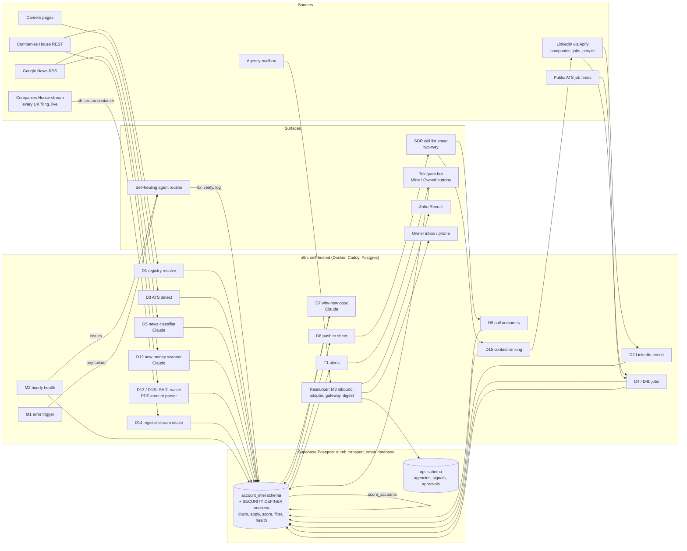

# gtm-engine

A signal-driven GTM system built by one non-developer in October 2026 with n8n, Postgres (Supabase) and Claude, self-hosted on a small cloud VM. It has three product surfaces on one architecture:

- `account-intelligence/`: a B2B account intelligence pipeline that takes an account executive's book of ~3,200 companies, validates each one against the UK companies register, enriches it, watches for buying triggers (open roles abroad, raises found on the register before any press, expansion, distributed teams), scores it per product, writes a one-line trigger and discovery question for the SDR, ranks the right buyer contacts, pushes a call list to a sheet and pulls outcomes back nightly. Failures fire an agent that fixes the pipeline inside fixed permission boundaries. The employer is not named anywhere in this repo.
- `resourcer/`: candidate inflow and screening for recruitment agencies (OpsAutomated's flagship product): application email in, CV parsed and scored against the job spec by an LLM, record created in the ATS, one-tap approval card to the consultant, branded acknowledgement to the candidate, morning digest to the owner.
- `hunter/`: BD signals for the agency's own pipeline (job adverts by recruitment agencies, Companies House, owner lookup, ICP score and a why-now line).

Numbers are in [RESULTS.md](RESULTS.md), generated weekly from one SQL function. The one serious incident is written up in [docs/POSTMORTEM-credit-incident.md](docs/POSTMORTEM-credit-incident.md).

## Architecture



Everything that decides something lives in SQL. n8n moves data between APIs and the database; Claude writes text and classifies; the sheet, the Telegram bot and the dashboard are queries over the same tables.

## Repo layout

```
workflows/
  account-intelligence/   D00-D15, T0, T1: the book-scoring pipeline (n8n JSON, scrubbed)
  resourcer/              inbound applications, ATS adapter, decision gateway, digest, CV test rig
  hunter/                 BD signals, owner lookup, outreach queue
  monitoring/             error trigger and hourly health check
supabase/migrations/      schema (0001), every function (0002), the results aggregate (0003)
infra/                    cloud-init, docker-compose, Caddyfile, backup script, stream listener
site/                     the marketing site source and its build/check pipeline
tools/                    workflow export, scrubber, results renderer
results/latest.json       aggregate snapshot the RESULTS.md is rendered from
docs/                     postmortem, scrubbing notes
.env.example              every variable and placeholder with a one-line description
```

## Subsystems

### Ingest and validation (D00, D01)

The raw book arrives as three columns: name, LinkedIn URL, website. `intel_upsert_accounts` dedupes on canonical domain, then on a normalised name (`ops.normalise_company_name` strips ltd/limited/llp/plc/uk/group/holdings and punctuation; it is a generated column with a unique index so the dedupe is enforced by the database, not by the workflow).

D01 proves each company is real. Companies House search on the brand name (the strapline after " - " is stripped), then a confidence tier: 1.0 exact normalised match, 0.9 domain stem or previous name, 0.85 prefix, 0.7 weak prefix or token overlap. A dissolved or liquidated company disqualifies the account only on a 1.0 match; anything weaker to a dead company is flagged for review. The profile adds SIC codes, incorporation date, `last_accounts.type` (a free size proxy: micro-entity, small, full) and a corporate PSC outside the UK (a foreign parent). `.ie` domains are capped at 0.7 because the Irish register is not integrated.

D03 fetches the homepage and, if nothing is found, the careers page: ATS provider by regex (Greenhouse, Lever, Ashby, Workable, Teamtailor, Recruitee, Personio, BambooHR, Workday, Pinpoint, JazzHR, Breezy, Bullhorn, JobAdder, Vincere, HiBob, Rippling), competitor mentions, and the page title, because "Account Suspended" or a casino landing page is a dead-business signal worth -40.

### Enrichment (D02, D04, D04b)

D02 calls a LinkedIn company actor on Apify, lands the raw JSON in `linkedin_raw`, and a SQL function maps each row back to an account by slug, then domain, then normalised name, before applying the disqualifiers (over 500 staff; an editable never-buy industry table). Raw rows are kept so a mapping bug is a re-run, not a re-scrape. `peopleStats` gives employees by country, which is the raw material for the distributed-team signal.

D04 reads public ATS JSON feeds for the 65 accounts with a detected ATS. D04b asks Apify for every LinkedIn job per company in the last month. One company per call, four in parallel: batches of ten silently returned nothing and one unresolvable slug poisoned a batch of three. Jobs are normalised with flags the scorer reads (country, remote-anywhere, contract language, visa language, on-site or rotational language, IT role, People role).

### Signals, including the register stream (D05, D12, D13, D13b, D14)

D05 runs Google News RSS per account through a Claude classifier into fixed kinds: funding (equity raises only), expansion, new office, project win, People hire, layoffs, acquisition, with an `ignored` kind added after grants and charity appeals were classified as raises.

D12 scans five funding-news queries hourly for UK/IE startups that are not in the book and adds them as net-new accounts. The audit of its first 28 finds against the CRM showed 26 were already owned by colleagues. Press is the slowest possible signal, so the pipeline went to the source:

- D13 polls the filing history (category `capital`) of every matched account. An SH01, a statement of capital following an allotment of shares, means new shares were issued, usually weeks before any announcement and often with no announcement at all.
- D13b downloads the SH01 PDF, extracts the text and reads shares allotted times amount paid per share. The week's allotments are summed per company and given a confidence: `confirmed` if press exists within 60 days, `check` above £50m (parser suspect), `likely` at £250k or more, `weak` below (option exercises, reclassified to ignored), `pending` until the PDF is parsed.
- D14 is the register-wide version. A 90-line Node listener (`infra/stream/listener.js`) holds one connection to the Companies House streaming API, forwards every SH01 filed by any UK company to a webhook over the Docker network, and resumes from a saved timepoint after a restart. The whole filter lives in one SQL function, `intel_register_intake`, which takes the event as jsonb: active ltd, incorporated within ten years, has SIC codes, no SIC in an excluded set (finance, property, construction, hospitality, retail, public sector and so on), name not holdings/nominees/property/capital/ventures/fund. Every event is logged with its outcome and reason so the filter is tuned from evidence. When a week's allotments reach £250k, `register_promote` creates an account of origin `register`, held off the call list until a person says it is theirs.

### Scoring (D06 as `intel_score_accounts`)

One plpgsql function scores every non-disqualified account on five product lines with separate weights, picks the best as lead product and the second as cross-sell, and writes the band (A at 70, B at 45, C at 20), a human-readable evidence line and a full breakdown as jsonb. Recent equity funding is the heaviest single signal (55/40/25 points by raise age). Distributed small teams (3 to 100 staff, people in four or more countries) were added as v1.6 after the SDR booked a meeting with a company the scorer had at C. Agencies are detected by industry, whole-word name regex and an adverts-versus-headcount heuristic, and their adverts are routed to the contractors line instead of the employer lines. Caps at B stop weak evidence making an A: under 10 staff with no live trigger, register-only raises with no hiring, a distributed team with nothing live, and any account whose last why-now pass found no usable trigger. Customers are never disqualified; they stay in the run as a calibration set (`v_calibration`).

Scoring runs again, hourly, whenever any account has a signal newer than its score (`intel_health` checks this), so a raise that lands at 11:00 is on the sheet at 12:00.

### Why-now copy (D07)

Claude Sonnet, temperature 0, structured output, reading only the signal rows the scorer used. Output is a trigger line under 25 words in the sales playbook format, one discovery question per product in the rep's own voice, a persona, a proof point and an evidence line for the SDR's eyes only. Rules that were added after reading real output: a country or city may be named only when an open role in that country or a news item proves it; register raises are spoken about with hedged language and never attributed to the register or given an amount; no vendor name in the trigger line; signals older than 45 days are "recently". A line is regenerated only when the scorer's evidence, the score version or the band changes (`why_now.scorer_evidence`, `band_at_generation`), which cut about 120 model calls a day and stopped lines drifting. An A with no usable trigger is dropped to B by the save function.

### Contact ranking (D15)

A shared tab on the SDR's sheet is the contract between two agents: a CRM-side agent writes companies that visited the website (A to D), this pipeline fills E to T every 15 minutes, and also queues 10 A/B accounts per run on its own. For each company, an Apify people actor returns up to 15 profiles filtered by seniority; the current title is taken from the experience row at that company (headlines are marketing), and a title table by headcount band ranks them: under 50 staff founder/CEO/MD then COO; 50 to 200 Head of People or HR Manager, then COO/FD, then founder; 200 plus HR Director or Head of People, then Talent, Finance, Payroll. Freelancers, advisers and bare "consultant" titles are dropped because LinkedIn's company filter attaches them loosely. Contacts are kept to name, title, URL and location and purged after 90 days.

### Delivery and outcomes (D08, D09)

D08 re-scores, calls `intel_sheet_rows` and writes system columns only (account, band, new, lead product, who to call, trigger line, discovery question, evidence, LinkedIn) with an append-or-update keyed on account_id. A removals branch takes customers, owned, disqualified and held accounts off the sheet. The data-validation rule on the Status column is re-applied after every push because deleted-and-reappended rows lose it. D09 pulls Status and Notes back nightly into `outcomes`, which is what RESULTS.md's meetings table reads. A live dashboard (ten SQL queries) sits on top of the same tables for 1-2-1s.

### Alerts (T0, T1)

T1 asks `intel_alert_next` for the next confident raise every five minutes and posts it to Telegram. Rules are strict by choice: one alert per account ever, headcount 10 to 500, £500k to £50m in a week, excluded industries, never a customer; press raises only when net-new and announced within two days; register raises only at `likely` confidence with no press. Accounts outside the book get Mine / Owned inline buttons; T0 handles the tap inside Telegram (answers the callback, edits the message so the buttons disappear, records the answer), and Mine releases the account to the sheet. n8n's Send-and-Wait node is deliberately not used anywhere because it lands the user on a tool-branded page.

### Monitoring and the self-healing agent (M1, M2, watchdog)

M2 runs `intel_health` hourly: applies landed raw rows, re-scores stale accounts, reads provider usage, and returns queues plus a list of issues (an enrichment queue with nothing received in two hours, raw rows that would not map, a sheet not pushed in a week, provider usage at 80% of cap, contact requests failing). M1 is the global error trigger. Both fire a hosted agent routine over HTTP when something is wrong.

The routine's permission boundaries are explicit: it may read the health report, inspect executions and fix workflow configuration; it may not delete data, change scoring weights, spend money or touch credentials. It verifies the fix, writes a row to `watchdog_log` (alert, cause, action, what is left) and emails a person only for human-only steps such as payment or credentials. It has fixed a regex-backtracking timeout in the careers scan on its own, with root cause.

## Three patterns worth naming

### The self-draining batch

Three bugs in the first day were the same bug. PostgREST caps any response at 1,000 rows, so a "load everything" call silently returned 1,000. A scheduled run that did not finish inside its interval collided with the next run and double-processed (rate-limit errors got saved as "no match"). The n8n task runner aborts a Code node that stays busy past about 30 seconds (250 pages of HTML through a regex did it). The one design rule that fixes all three: every bulk step is a schedule plus a claim-on-load RPC that stamps `attempted_at` and returns at most N rows, N chosen under both the 1,000-row cap and the 30-second budget; the run stops when the load returns nothing; errored rows get a cooldown and retry. Successful scheduled runs are not saved, so progress is judged from the database, never from the executions list.

### Dumb transport, smart database

n8n nodes fetch and post. Dedupe, status rules, filters and thresholds live in SECURITY DEFINER functions in `public`, because the `account_intel` and `ops` schemas are not exposed to PostgREST. `ingest_signal` is one INSERT ... ON CONFLICT so parallel n8n branches cannot race. `intel_register_intake` takes the whole stream event as jsonb, so the register filter changes without touching n8n or the listener container. Row-level security is on with no policies: only the service role can read or write, and only through the functions.

### Two-agent handover over a shared sheet

Two AI assistants that cannot share a tool (one has the CRM and the dialler, one has n8n and the database) coordinate through a sheet tab. Each owns fixed columns, a status value is the handshake, and each is the authority on its own tools. It is the cheapest cross-tenant integration that exists, and it has been running since 22 Oct.

## Results

See [RESULTS.md](RESULTS.md) for the live numbers with the SQL that produces them. The short version at the time of writing: 3,316 accounts; 2,840 matched to the register; 86% LinkedIn enrichment success; 44 register raises of £250k+ in the last six months with no press within 60 days of the allotment; 1,421 register events filtered to 28 promotions; 970 buyer contacts for 271 companies at a 92% found rate, 3.6 per company; roughly $0.018 per enriched account on the scraping provider this cycle; LLM spend under $20 across the whole build; two existing customers back-tested as A 95 and B 55 from public signals alone; 3 meetings marked by the SDR in the first two weeks, 2 of them in the first seven days, from the first 30 accounts worked. Meetings booked from the rep's own email sequences are tracked in the CRM and are not in these numbers.

## Known gaps and next steps

- Outcome volume is small. Three meetings is a direction, not a conversion rate. The thresholds are round-number judgement calls and are not changed until outcomes say where meetings sit.
- The register stream listener needs an external liveness check; the last event received is visible in RESULTS.md and a stall is only noticed by reading it.
- Row-level security is enabled on nine tables, not all of them. Every write already goes through SECURITY DEFINER functions with the service role, so there is no exposure, but it should be uniform.
- No evals as code. Prompt quality was judged by reading output after each scorer change. A golden set for the news classifier and the trigger-line writer is the next build.
- Per-client configuration in the recruitment stack is in Config nodes rather than a config sheet; templates sit inside nodes; the test guard is a domain check.
- Alerts, health and the error trigger run on the same VM they monitor. An external uptime check on the two `/healthz` endpoints is on the list.
- The Irish register (CRO) is not integrated; `.ie` accounts are capped at 0.7 match confidence.
- The public ATS job feed coverage is low (65 accounts) because most of the book runs no ATS the scan can see; LinkedIn jobs carry the signal.

## How this was built

Built between 30 Sept and 26 Oct 2026, evenings and weekends, by one person who sells for a living and does not write code, working with Claude as build partner. The working method that made it possible: Claude connected to n8n and Supabase through MCP, writing nodes and SQL directly; the person reviewing, publishing and holding every credential and OAuth client; one node at a time against the live UI, never from memory; every decision and every bug written into a session log the same day. Three n8n modules were built in the first two afternoons; the recruitment stack was proven end to end (application email to acknowledged candidate in under a minute) by day eight; the account-intelligence pipeline went from an xlsx to a live, monitored call list in one day and gained the register stream the next.

The export in this repo was produced by `tools/export_workflows.sh` and `tools/scrub.py`; see [docs/SCRUBBING.md](docs/SCRUBBING.md) for what was replaced and why. The scrub rules themselves are not committed because they contain the identifiers they remove.

## Running it

This is a reference, not a one-click install. To stand it up: provision a VM from `infra/cloud-init.yaml` (set the two hostnames), add DNS, apply the three migrations to a Supabase project, create the credentials listed in `.env.example` inside n8n, replace the `SHEET_ID_*`, `YOUR_SUPABASE_PROJECT_REF`, `TELEGRAM_CHAT_ID` and `ROUTINE_ID` placeholders in the workflow JSON, import with the n8n CLI, and publish the schedules. The recruitment stack additionally needs a Zoho Recruit tenant and a Google Workspace mailbox.
